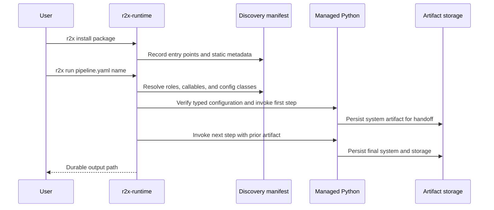

# r2x-cli Architecture

`r2x-cli` is a Rust CLI product for model interoperability. It keeps plugin discovery,
package management, pipeline execution, and Python runtime setup behind one
command-line interface.

## Runtime flow

The installed `r2x` command is the r2x-cli launcher. The adjacent
`r2x-runtime` payload contains the CLI implementation. Commands that do not
need Python, such as `r2x --version`, can run without creating the managed
environment. r2x-cli plugin installation, discovery, pipeline execution, and
system inspection use the `uv`-managed environment.

## Workspace crates

| Crate | Responsibility |
| --- | --- |
| `r2x-cli` | Command definitions, plugin management, pipeline execution, and system inspection. |
| `r2x-config` | Configuration paths, Python version selection, `uv` discovery, and virtual environment management. |
| `r2x-manifest` | Plugin manifest storage, package metadata, and runtime bindings. |
| `r2x-ast` | Static analysis of installed Python packages to discover plugin entry points. |
| `r2x-python` | PyO3 bridge and plugin invocation through the managed Python runtime. |
| `r2x-artifacts` | JSON and ZIP artifact handoff, sidecar directories, and durable pipeline boundaries. |
| `r2x-logger` | Structured logging, verbosity, log files, and plugin output handling. |
| `r2x-build-support` | Build-time Python ABI detection and validation for PyO3 builds. |

## Plugin discovery

r2x-cli does not import every installed plugin to build its manifest. The AST
scanner reads package files and records the plugin metadata needed to invoke
entry points later. This keeps installation and synchronization from executing
arbitrary plugin import side effects.

The manifest records r2x package and plugin metadata, including source
information, module names, callable names, configuration modules, and plugin
roles. At run
time, the manifest is resolved to Python call targets and the selected plugin
runs inside the managed environment.

## Pipeline boundaries

A pipeline can pass a System through a Unix pipe when all steps belong to one
job. The producer writes JSON to stdout, sidecars are kept in the r2x-cli
cache-backed location, and diagnostics are written to stderr.

Use `-o` and `-i` when the boundary must survive across jobs or be tracked by a
workflow manager. A durable JSON entrypoint is stored beside its
`<stem>_time_series/` directory. Keep the entrypoint and sidecars together.

## Why discovery, execution, and inspection are separate

Discovery reads entry points and Python source metadata without importing every plugin.
It can report available names and configuration fields, but it does not prove that a callable will import or that its data is valid.
The [first tutorial](getting-started.md) therefore checks discovery, prints configuration, executes the pipeline, and independently reloads its artifact.
Those checks answer different questions.

The preview flags also have different limits.
Dry-run resolves every step against the discovery manifest and rejects unknown or ambiguous references.
A resolved manifest entry still does not prove that its Python package can import; package and typed-configuration validation occur during actual execution.
A successfully executed plugin can still create a semantically incorrect model, so component/value assertions remain the workflow author's responsibility.

A pipeline uses the artifact layer to preserve component and time-series storage between steps.
A durable output path makes that boundary usable by another job; a ZIP packages it for transport.
Neither representation installs Python component classes in the next environment.
See [artifact inspection](inspect-artifacts.md) for the concrete file and module boundaries.

## Ecosystem responsibilities

[r2x-core](https://github.com/NatLabRockies/r2x-core) supplies the System, PluginContext, configuration, and lifecycle APIs.
Model packages such as [r2x-reeds](https://github.com/NatLabRockies/r2x-reeds), [r2x-plexos](https://github.com/NatLabRockies/r2x-plexos), and [r2x-sienna](https://github.com/NatLabRockies/r2x-sienna) own native schemas, parsers, and exporters.
[R2X](https://github.com/NatLabRockies/R2X) supplies mappings between model schemas.
The CLI orchestrates installed contracts; it does not own those model-specific rules or input datasets.
