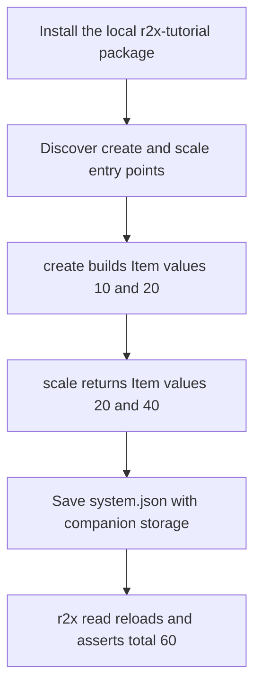

Run two installed plugins: one creates a system containing values 10 and 20; the next doubles them.
Save the resulting system and verify values 20 and 40 through `r2x read`.
The [complete fixture package](https://github.com/NatLabRockies/r2x-cli/tree/main/docs/examples/first-pipeline) is included in this repository and needs no model dataset or licensed software.
This example teaches the generic CLI contract; native ReEDS, PLEXOS, and Sienna workflows belong in their [model packages](https://natlabrockies.github.io/R2X/explanation/architecture/) and [R2X tutorials](https://natlabrockies.github.io/R2X/tutorials/getting-started/).



## Before you begin

Complete [Installation](installation.md), [Python environment setup](environment.md), and [Verify the CLI](verify-installation.md).
This tutorial additionally needs Git to obtain the shipped example package.
The commands use a macOS or Linux shell; the example needs no external model dataset.
It was exercised with CLI 0.1.15, Python 3.12, and r2x-core 0.9.0.

## Obtain and inspect the fixture

Use a fresh directory so you do not overwrite another checkout:

```bash
git clone --depth 1 https://github.com/NatLabRockies/r2x-cli.git
```

Enter the shipped example:

```bash
cd r2x-cli/docs/examples/first-pipeline
```

The example contains `pyproject.toml`, its `src/r2x_tutorial/` module, `pipeline.yaml`, and `inspect_system.py`.
No Rust build is required: you are installing a small Python package with the released CLI.
Read `pyproject.toml` to see the actual entry-point names:

```toml
[project.entry-points."r2x.parsers"]
create = "r2x_tutorial.plugin:CreateDemo"

[project.entry-points."r2x.transforms"]
scale = "r2x_tutorial.plugin:scale_values"
```

The group declares the runtime role; `create` and `scale` are the CLI references.
The parser is a `r2x_core.Plugin` class; the transform is an `@expose_plugin` function accepting a `System` and typed configuration.
See [core's lifecycle contracts](https://natlabrockies.github.io/r2x-core/references/plugins/) when writing your own implementations.

## Install and verify discovery

From this example directory, install the local package in editable mode:

```bash
r2x install -e .
```

This changes the CLI's managed environment and discovers the package's entry points.
Confirm the package and both plugins:

```bash
r2x list r2x-tutorial
```

Expect `create` as a class plugin and `scale` as a function plugin.
Inspect each plugin's generated help rather than guessing its options:

```bash
r2x run create --help
r2x run scale --help
```

`create` accepts `--name`; `scale` accepts `--factor`.
The implementation defaults are `name="demo"` and `factor=2`, with `factor > 0` enforced by its typed configuration.
If these names are missing, stop and use [discovery troubleshooting](troubleshooting.md#the-tutorial-plugin-is-not-found).

## Read the real pipeline

The supplied `pipeline.yaml` contains:

```yaml
pipelines:
  double-values:
    - create
    - scale
config:
  create:
    name: cli-tutorial
  scale:
    factor: 2
```

The ordered list selects installed plugins; `config` maps those same references to their settings.
`create` builds a system named `cli-tutorial` with two `Item` components.
`scale` receives that system and multiplies each value by two.
See the [command/configuration reference](cli-reference.md#pipeline-configuration) for the contract boundaries.

List the named pipeline:

```bash
r2x run pipeline.yaml --list
```

Expect `double-values (2 steps)` and the `create`, `scale` order.
Print the resolved settings:

```bash
r2x run pipeline.yaml double-values --print
```

Confirm `name: cli-tutorial` and `factor: 2` before executing.
Then preview the flow:

```bash
r2x run pipeline.yaml double-values --dry-run
```

Expect `create → stdout`, followed by `scale ← stdin → stdout` in the displayed plan.
These are flow labels; the named pipeline manages the handoff internally.
`--list`, `--print`, and `--dry-run` inspect configuration/flow without executing plugins.
They do not prove package availability, validate every plugin config, or load model data.
Actual execution verifies installed packages and typed configuration before running the steps.

## Save the result

Choose a durable output path:

```bash
r2x run pipeline.yaml double-values --output output/system.json
```

Expect successful `create [1/2]` and `scale [2/2]` messages and `Output bundle saved to: output/system.json`.
Timings and log-file paths vary by machine.
Inspect the generated files:

```bash
ls output
```

Expect `system.json` and `system_time_series/`.
The companion directory is part of the system artifact even when this simple fixture has no attached time-series values.
Keep the two together when copying a JSON bundle.

## Reload and check the saved result

After installing the fixture, reproduce the inspection invariants directly with its public APIs:

```python doctest
>>> from r2x_core import PluginContext
>>> from r2x_tutorial.plugin import CreateConfig, CreateDemo, ScaleConfig, Item, scale_values
>>> context = PluginContext(config=CreateConfig(name="cli-tutorial"))
>>> system = CreateDemo.from_context(context).run().system
>>> system = scale_values(system, ScaleConfig(factor=2)).unwrap()
>>> items = sorted(system.get_components(Item), key=lambda item: item.name)
>>> # Expected: the two original values, 10 and 20, were doubled.
>>> [item.value for item in items]
[20.0, 40.0]
>>> # Expected: the same invariant checked by inspect_system.py after r2x read.
>>> assert len(items) == 2 and sum(item.value for item in items) == 60
```

The shipped `inspect_system.py` applies the same checks to `sys`, the loaded system supplied by `r2x read`.
It does not construct a replacement for the saved artifact.
Run the check:

```bash
r2x read --exec inspect_system.py output/system.json
```

Among the overview messages, expect:

```text
2 items; total=60.0
```

The script asserts the component values, so a wrong transformation exits unsuccessfully rather than merely printing a plausible-looking artifact.
The first `read` can install its inspection dependencies into the managed environment and therefore needs network access.
The model module must still be importable when an artifact is loaded.

## Continue

Use [artifact inspection and transfer](inspect-artifacts.md) for direct-plugin file boundaries, ZIP archives, and repeatable checks in another environment.
Use [plugin management](plugin-management.md) when moving from this editable fixture to published model packages.
Run `r2x init new-workflow.yaml` to create a starter file for your own pipeline; replace its example plugin names before executing it.
For real model inputs, follow the [R2X workflow tutorials](https://natlabrockies.github.io/R2X/tutorials/getting-started/) and the relevant parser package's input requirements.
