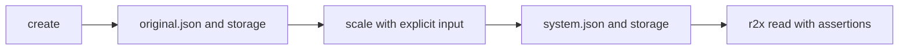

Use this guide after [the first pipeline](getting-started.md), from `docs/examples/first-pipeline` with `r2x-tutorial` installed.
The commands below use its actual `create`, `scale`, and `Item` contracts.
A system artifact contains component metadata and storage; a native model export may have a completely different schema.

## Choose a boundary that survives another command



For independent jobs, save the first result instead of relying on another process's in-memory state:

```bash
r2x run create --name direct-demo --output output/original.json
```

Use that artifact as the transform's explicit input:

```bash
r2x run scale --factor 2 --input output/original.json --output output/system.json
```

Verify the output through the same inspection script:

```bash
r2x read --exec inspect_system.py output/system.json
```

Expect `2 items; total=60.0`.
`--input` and `--output` make the artifact boundary visible and repeatable.
When `--output` is supplied, pass its file to `read`; piping an empty stdout stream into `read` is not equivalent.
Keep each JSON entrypoint beside its `<stem>_time_series/` directory.

## Use a ZIP for a single transport file

Create an infrasys system archive from the named pipeline:

```bash
r2x run pipeline.yaml double-values --zip --output output/system.zip
```

Load it as a ZIP rather than treating it as JSON:

```bash
r2x read output/system.zip --zip --exec inspect_system.py
```

The inspection again checks values 20 and 40.
The archive bundles the system and storage, but it does not install the Python model classes used by its components.
Install the same model package in the receiving CLI environment before loading it.
For this fixture that package is the local `r2x-tutorial`; for production workflows it may be [r2x-sienna](https://github.com/NatLabRockies/r2x-sienna) or [r2x-plexos](https://github.com/NatLabRockies/r2x-plexos).

## Inspect interactively after a repeatable check

Keep the script's assertions and then open the interactive session:

```bash
r2x read output/system.json --exec inspect_system.py --interactive
```

The loaded system is `sys`; `sys.info()` prints its overview.
Query its public component API:

```python
from r2x_tutorial.plugin import Item

[(item.name, item.value) for item in sys.get_components(Item)]
```

Exit with `exit()`.
For library-only loading, see [core's fresh-process artifact tutorial](https://natlabrockies.github.io/r2x-core/tutorials/getting-started/) and [infrasys](https://github.com/NatLabRockies/infrasys).

## Diagnose portability failures

If loading cannot import a component module, install its package into the CLI environment and retry.
If a storage path is missing, transfer the companion directory or recreate the ZIP from the source bundle.
If the script reports incorrect values, check the resolved pipeline with `--print`, then rerun into a new output path and inspect that exact artifact.
An older successful output can remain on disk after a later failed run; file existence alone is not a success check.
See [troubleshooting](troubleshooting.md) for command, discovery, and ABI failures.
